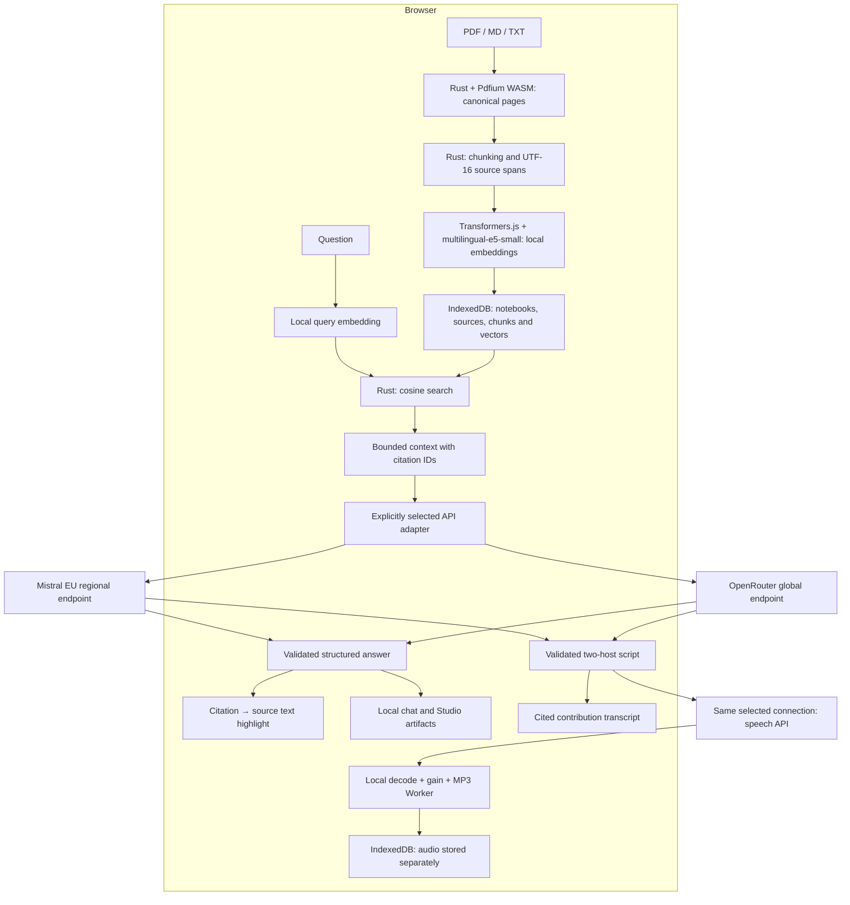

# ResearchBench · v0.0.4

**Your sources. Your knowledge. Your browser.**

**Live demo:** [research-bench.nachtigall.dev](https://research-bench.nachtigall.dev/)

A browser research workbench built for the Everlast Consulting test assignment:
upload documents, ask grounded questions, inspect the exact cited passage, and
turn a notebook into a summary, FAQ, study guide or a cited two-host podcast.

Documents, chunking, embeddings, indexing and semantic search run locally.
Generation uses your own **Mistral La Plateforme** key by default, with
**OpenRouter** as an explicit alternative. There is no application backend.

## Run locally

Requirements: Node.js 22.17 or later, pnpm 11.28.5, Rust/Cargo and the
`wasm32-unknown-unknown` target. The first setup needs network access to download
public dependencies and pinned model/runtime assets.

```sh
pnpm install --frozen-lockfile
rustup target add wasm32-unknown-unknown
pnpm assets:prepare
pnpm wasm:build
pnpm dev
```

Open the URL printed by Vite. In **Settings**, select the API connection and
enter its key. Keys stay in `sessionStorage`, survive reload in that tab, and
are never included in the build, IndexedDB or repository. Browser session or
crash recovery can restore sessionStorage after closing a tab. Use **Remove
saved key** in Settings to explicitly remove it. Any script running on this
origin can access a saved key; the app therefore renders untrusted content as
text and uses a restrictive Content Security Policy. Local search works without
any key.

`wasm:build` installs the pinned wasm-bindgen CLI into the project's
`.cache/tools` when necessary. Native ONNX installation scripts are deliberately
disabled: inference uses ONNX Runtime Web in a browser Worker. TypeScript 6 is
pinned because SvelteKit currently requires its JavaScript compiler API.

## What you can do

- Create, rename and remove notebooks; import multiple PDF, Markdown and TXT sources.
- Search semantically in German and English using local multilingual embeddings.
- Ask questions and click citations to open the exact highlighted source span.
- Generate summaries, FAQs and study guides with the same citation contract.
- Create DE/EN podcasts with two voices, contribution-level cited transcripts,
  an MP3 player, speed controls and a downloadable episode.
- See whether a generated item covers the complete text or a bounded selection.
- Reload without losing sources, indices, chat or generated material.
- Cancel indexing/generation, change API connection, remove sources or wipe all app data.

### Podcasts

Open **Studio → Podcast**. English is selected by default; **German (experimental)**
is available explicitly. Optionally use
**Test voices** before creating an episode. The short voice test uses fictional
text and no documents; it makes two billable speech requests. Podcast creation
makes one script request and up to 24 sequential speech requests. No request is
retried automatically. The same selected connection and its session key are used
for both writing and speech. An episode targets roughly 3–5 minutes; smaller source sets
may produce shorter conversations. Both hosts explain, develop ideas and ask
questions; their roles are tendencies rather than a fixed interview.
Previously saved German episodes remain available when selecting German.

The pinned speech model is `voxtral-mini-tts-2603` for Mistral direct and
`mistralai/voxtral-mini-tts-2603` for OpenRouter. The presets are
`gb_oliver_curious` and `gb_jane_neutral`. Direct Mistral resolves their actual
voice IDs through the EU voices endpoint before generating a script. These are
British voice presets: German pronunciation and transitions require a listening
test; no native German quality is promised and no substitute voice is chosen.
The first owner listening test accepted English but found a strong accent in
German. The interface labels German speech as experimental.

Mistral returns lossless WAV. OpenRouter currently uses MP3 because its documented
raw PCM option does not establish a reliable sample layout/rate. Each input is
decoded locally and the contributions plus short pauses are encoded once into
a mono 24 kHz, 64 kbit/s MP3 in a dedicated Worker. OpenRouter therefore involves
an additional lossy encoding step. Files are never assembled by concatenating
MP3 bytes. Timing follows decoded contribution lengths, including encoder
priming/padding; it is **contribution-level**, not word alignment. There is no
guarantee that separately spoken turns have identical tempo/intonation. New
episodes use local per-contribution RMS gain adjustment, capped at 3× with a
0.92 peak ceiling; silence remains unchanged. This is a bounded gain adjustment,
not a broadcast loudness certification.

The recommended player setting preserves pitch and uses 1.3× for German, and
1.2× for Oliver / 1× for Jane in English, following the first listening feedback.
Manual speed selection overrides it. The MP3 download retains the original
speech tempo; changing playback speed does not rewrite the downloaded file.

Completed speech segments are saved after each contribution. On cancellation or
failure, **Resume** explicitly requests only the missing contributions using
the frozen voices, language and provider. A replacement key for that provider is
allowed; switching provider requires selecting the original provider to resume.
Changed sources require a new episode. Removing/replacing a key, switching
provider or changing notebooks aborts active processing. Already issued requests
can still incur charges. An existing finished episode stays available until its
replacement is successfully committed.

Web Locks prevent simultaneous renders of the same notebook/language across tabs.
Closing a tab releases its lock; explicit resume claims a fresh persisted render
identity. Every write also checks the notebook revision, data-wipe epoch, config
signature and render identity. Browsers without Web Locks can play saved episodes
but cannot render/resume. Script metadata, final MP3 and replacement cleanup are
committed in one short IndexedDB transaction; network requests, decoding and
encoding happen outside it. Audio blobs live in a separate store and load lazily,
not in application snapshots. Deleting an episode, notebook or all local data
also removes its audio. Old episodes remain labeled stale after source changes,
and removed source references become unavailable.

The renderer enforces ten minutes of decoded audio, 128 MiB of accounted audio
buffers and a 30-second encoding watchdog. These bounds are not measurements of
the browser's entire process heap. The recorded fixture benchmark and the open
real-voice acceptance gates are in [the verification report](docs/verification.md).

The interface defaults to English, regardless of the browser language. Use the
header language selector to switch the entire interface to German. This choice
is saved locally; switching still works in memory if preference storage is blocked.
Dialogs, progress, errors, source controls and accessibility labels update live.
Switching language does not interrupt indexing, generation or audio playback.

Chat and Studio text generation use the interface language captured when the
operation starts, unless the question explicitly requests another language.
Existing notebook names, source text and generated content are preserved.
Podcast speech has its own language selector: English stays the default in either
interface language, and German remains experimental because native German voices
are unavailable. Source viewing displays extracted text with PDF page anchors,
not overlays in the original PDF.

## Architecture



### Rust and Workers

The Rust crate provides strict UTF-8 decoding, canonical per-page text, fixed
Unicode-scalar windows with overlap, exact half-open **UTF-16** spans for browser
highlighting, and cosine retrieval over a row-major `Float32Array`. Window
defaults are 1,000 characters with 200 overlap, confined to each page.

`pdfium-render` binds a separately shipped, pinned Pdfium WASM module. The JS
bridge only initializes modules and transports results; PDF parsing remains in
the Rust/Pdfium path. Pdfium calls and ONNX inference run off the main thread.
Cancellation terminates the Worker, including synchronous parsing/inference.
There is one primary PDF parser; alternative parsers are not silently selected.

### Local embeddings

The default is quantized **multilingual-e5-small**, pinned to the ONNX revision
in the asset manifest. Queries use `query:`, passages use `passage:`, followed
by mean pooling and normalization. The 512-token limit includes prefixes and
special tokens; oversized windows are split again without losing source spans.
Long current questions are rejected rather than silently truncated. Previous
questions are included only within the remaining token budget.

The first import downloads approximately 160 MB of model, tokenizer and needed
WASM runtime assets **from this app's origin**. The complete deployment asset
set is larger because it includes runtime variants and license notices. Browser
caches can be evicted; their persistence is not guaranteed. Model and tokenizer
files, including their notices, use a content-addressed
`/models/<asset-set-sha256>/multilingual-e5-small/` namespace with immutable HTTP
caching. Runtime/PDFium and legacy unversioned paths require revalidation. Remote model loading
is disabled. E5 was chosen for multilingual retrieval, browser-ready ONNX
weights and a bounded download, rather than model novelty.

### Data integrity and provenance

Notebook and source IDs exist from the first import. A source becomes searchable
only when its pages, chunks and vectors have been committed atomically.
Parser/model/pipeline versions accompany the index; incompatible indices request
reindexing. Each operation captures notebook/source revision and API configuration.
Revision checks and abort-aware transactions prevent canceled or outdated jobs
from saving results into a changed or deleted notebook.

Chat sends at most four conversation pairs from the current source revision.
Source changes start a new active conversation context; old visible answers and
Studio items remain labeled as referring to an older source state. Deleted
citations are unavailable. API switches abort active generation; there is no
automatic cross-provider or cross-region fallback.

### Grounding and Studio coverage

Chat uses the top six local retrieval results. Both adapters request a JSON
schema and normalize into one client-side validated answer type. Only citation
IDs from the actual submitted context can become clickable references.
Request and validation bounds derive from the same schema. A section may cite
up to the number of distinct transmitted passages; there is no fixed twelve-reference
cap. Size violations produce diagnostics without revealing response contents.
Validation proves source-ID membership and exact navigation, **not** whether a
model's factual claim is truly entailed by the cited passage. Citations identify
the supplied source; ResearchBench does not fact-check it against outside
information. Documents are untrusted prompt data. A malicious source can still
steer generated statements or include misleading/phishing text despite the
system prompt and schema checks. Such output is displayed as escaped text,
without automatic links, HTML or tool execution.

Studio generators use the whole canonical source text up to 24,000 characters,
without repeated overlap. Larger notebooks use a round-robin selection of
spread-out, non-overlapping passages from all sources. The UI shows selected
sources, text coverage and the selection limitation. This is not advertised as
a complete summary of a large notebook.

## API connections

| Connection | Endpoint | Default model |
| --- | --- | --- |
| Mistral direct (default) | `https://api.eu.mistral.ai/v1/chat/completions` | `mistral-small-2603` |
| OpenRouter (alternative) | `https://openrouter.ai/api/v1/chat/completions` | `mistralai/mistral-small-2603` |

Speech uses `/v1/audio/speech` on the same provider origins. Direct voices are
listed at `https://api.eu.mistral.ai/v2/audio/voices`; OpenRouter voice support is
checked in its public model list. The speech adapter requests OpenRouter
`provider: { zdr: true, data_collection: "deny" }`. `require_parameters` is a
chat-routing field and is not sent to speech. Unsupported privacy/voice/model
combinations fail visibly instead of changing provider, region or privacy flags.
See [Mistral speech](https://docs.mistral.ai/studio/audio/text_to_speech/speech)
and [OpenRouter speech](https://openrouter.ai/docs/guides/overview/multimodal/tts).

Each connection has its own session key. Only the selected connection receives a
generation request. OpenRouter's adapter requests `data_collection: "deny"`,
`zdr: true` and `require_parameters: true`. Those fields are never sent to
Mistral. Missing eligible endpoints cause a visible error; privacy requirements
are not relaxed automatically. Requests use no tools, web-search plugins, OCR
APIs, file-upload APIs or external embedding APIs.

Invalid keys, insufficient credits/access, unavailable regional models,
rate limits, invalid JSON/citations, timeouts and cancellation have separate
user-facing outcomes. Raw provider error bodies are not displayed or logged.

Use a funded key and the paid, pinned model for a live demo. A free-model quota
or model switch is not part of the reliable demo path. No credits are bought or
keys created by the setup scripts.

## Privacy and GDPR: precise boundaries

1. **Local processing:** original documents, canonical text, embeddings and indices
   are stored in this browser profile. Import and search send no document content
   to an external service. The app has no analytics, tracking cookies or document backend.
2. **External generation:** selected excerpts, questions/generation instructions,
   bounded conversation history and the chosen API's authorization key leave the
   browser when the user starts generation. The selected API connection is visible.
   For small notebooks, this selection can include the complete canonical source
   text; complete coverage is not a promise that only a few snippets leave the browser.
   For podcasts, the grounded script's spoken contributions are additionally sent
   to that connection's speech API. Scripts, downloaded segments and finished MP3s
   persist locally. The voice probe sends fictional test text only. Mistral voice
   discovery makes an authenticated request to its EU voices endpoint; OpenRouter
   model discovery uses its public, unauthenticated catalog. Keys travel only in
   authorization headers, separate from the prompt or speech body.
3. **Mistral:** ResearchBench targets the EU regional inference endpoint. This is
   a processing-location choice, not a universal GDPR compliance assertion.
   Mistral documents EU/EFTA infrastructure and control-plane metadata that may
   remain outside the selected inference geography. Training opt-out and retention
   are separate account controls. Paid usage alone does not activate ZDR; it must
   be requested and approved. ResearchBench does not inspect or certify those settings.
4. **OpenRouter:** the standard connection goes through OpenRouter, a US company,
   and is forwarded to the selected model endpoint. ZDR and data-collection filters
   constrain eligible upstreams; they do not make the standard gateway EU-resident.
   OpenRouter currently documents Business/Enterprise regional routing, where
   prompts are decrypted and processed in-region, and a DPA through its Terms of
   Service (signed copies on request for Business). These are not properties of
   ResearchBench's default OpenRouter connection.
5. **Deletion:** the confirmed app-data wipe aborts active work and clears its
   IndexedDB records, in-memory state, session keys and its named CacheStorage
   model cache. Public static assets may remain in the browser-managed HTTP cache;
   the app cannot selectively clear that cache. No user documents or keys are
   stored in these public asset files. It does not delete unrelated origin data or retract requests already processed
   by an external API. The non-content interface language preference is retained.
   Static hosting can retain access metadata under its own policy.

Authoritative sources (reviewed October 2026): [Mistral regional inference](https://docs.mistral.ai/inference/regional-inference),
[Mistral training controls](https://help.mistral.ai/en/articles/347617-do-you-use-my-user-data-to-train-your-artificial-intelligence-models),
[Mistral ZDR](https://docs.mistral.ai/admin/monitor-comply/zero-data-retention),
[OpenRouter routing](https://openrouter.ai/docs/guides/routing/provider-selection),
[OpenRouter ZDR](https://openrouter.ai/docs/guides/features/zdr),
[OpenRouter Business and DPA](https://openrouter.ai/business).

The [DSK orientation on RAG (October 2025)](https://www.datenschutzkonferenz-online.de/media/oh/DSK_OH_RAG.pdf)
explains why RAG does not automatically settle data protection questions. Local
storage, bounded disclosure, transparent provenance and deletion support a
privacy-conscious design; lawful production use still depends on the actual
documents, purpose, contracts and provider configuration.

## Limits and deliberate trade-offs

- Text-based PDF, UTF-8 Markdown and TXT; scanned/image-only PDFs need OCR and are rejected.
- 10 MiB/file, ten sources, 500,000 canonical characters and 1,000 chunks/notebook.
  Character limits count **extracted** text: PDF extraction covers text within the
  page bounds (invisible and white text are extracted; graphic-only pages are not),
  so a PDF's extracted text can be smaller than its visible content, and pages
  without extractable text are reported in the source viewer.
- A five-minute local job watchdog prevents indefinite processing; the watchdog
  resets while a job keeps reporting progress, so sources within the documented
  limits index to completion; smaller sources may still be needed on slow devices.
- Fixed-size chunking is simple and testable, but can cut semantic boundaries.
- No cloud sync, collaborative accounts or encryption at rest beyond the browser's storage protections.
- Primary acceptance browsers are Chromium and Firefox, including CPU/WASM without WebGPU.
- Experimental WebLLM generation is an optional bonus and is not included in this version.

The differentiator is the combination of zero server setup for the visitor,
Rust/WASM provenance, multilingual local retrieval, explicit provider choice,
bounded disclosure and cited learning artifacts. This repository does not claim
to be the only product with that combination or that Rust alone improves retrieval.

## Verification

```sh
pnpm verify
pnpm assets:prepare -- --verify
PLAYWRIGHT_BROWSERS_PATH=.cache/ms-playwright pnpm exec playwright install chromium firefox
pnpm test:e2e
pnpm test:security
```

Tests cover Unicode spans, retrieval math, schema/citation validation, provider
request isolation, IndexedDB revisions and cancellation. The browser suite uses
the actual Rust/Pdfium Worker and local E5 model, original DE/EN fixture PDFs,
reload/notebook isolation, exact highlights, all three generators, bounded
coverage, unsafe source rendering and deletion. API responses use route mocks
with test-only keys; actual account entitlements and live generation require a
manual test using the key entered in the UI.

The i18n tests cover English defaults, persisted/blocked preference storage,
live dialogs and errors, language changes during indexing and generation,
preserved source highlights and podcast playback, and the independently selected
experimental German speech option in both browsers.

The reproducible checks, release gates and coverage limits are in
[the verification report](docs/verification.md).

## Static deployment and submission

Build from a clean committed checkout so the application and its source offer
share the exact Git commit identity.

```sh
pnpm build
pnpm source:prepare --expected-head "$(git rev-parse HEAD)"
pnpm preview
```

Publish the **entire** `build/` directory, including models, runtimes and notices,
to an HTTPS static host with SPA fallback to `index.html`. WASM must be served as
`application/wasm`, JavaScript modules with a JavaScript MIME type. Missing assets
under the app/model/runtime directories and dotfiles must return 404; extensionless
paths return the SPA shell, including mistyped paths. The fallback is not an
authorization or existence check. No runtime
environment secrets or proxy service are needed. CI verifies builds/tests and
does not push, deploy or publish a release.

### Generic hosting security contract

Production uses a hashed SvelteKit CSP meta placed directly after the charset,
before scripts, preloads and resource links. It authorizes the exact bootstrap
hash, same-origin scripts/styles/fonts and same-origin module Workers. The
HTTP CSP adds framing protection and resource restrictions; all applicable
policies are enforced together. Neither policy can relax the other.

The effective policy denies objects, frames, base URLs and form navigation.
Connections are limited to this origin, `https://api.eu.mistral.ai` and
`https://openrouter.ai`; images may use same-origin/data URLs and audio may use
same-origin/blob URLs. Inline script attributes, arbitrary inline scripts,
JavaScript evaluation and blob Workers are denied. The only inline style
attribute exception is the verified SvelteKit accessibility-announcer hash.
Worker responses carry their own policy allowing same-origin imports and WASM
compilation, with same-origin connections and no nested Workers. Document WASM
compilation remains disabled while all application WASM runs in Workers.

Required HTTP headers include `X-Frame-Options: DENY`,
`Strict-Transport-Security: max-age=31536000` on HTTPS,
`X-Content-Type-Options: nosniff` and `Referrer-Policy: no-referrer`.
HSTS does not include subdomains or preload. Versioned model assets and hashed
app assets use immutable caching; entry HTML and fixed runtime paths revalidate.
The hosting checker verifies the combined policies, bootstrap hashes, worker
policies and exact artifact bytes. Browser tests must also prove permitted
features work and forbidden actions are blocked under the delivered policies.
There is no external CSP-reporting endpoint. `robots.txt` and `security.txt`
are not included in this release.

`pnpm release:prepare` creates a content-addressed build snapshot;
`pnpm release:verify <directory>` checks its complete file inventory and hashes.
For public-origin checks, use `pnpm hosting:check --url <https-origin> --release <directory>`
and set `RESEARCHBENCH_HOSTING_URL` to that origin before running
`pnpm test:hosting`. API calls in the hosting browser suite are mocked.

Before submission, verify the exact production build on the live domain while
the GitHub repository is still private. Complete real-key Mistral acceptance and
check generated claims against the imported sources. Then the owner makes the
repository public. Record a 6–8 minute English demo with OBS Studio and publish
it as an unlisted YouTube video (hard limit: ten minutes), using
[the recording script and acceptance checklist](docs/demo-script.md) and
[the public NIST source corpus](docs/public-demo/README.md). Loom is not required.
Prepare and verify chat, Summary, FAQ, Study Guide and podcast before recording;
one optional live chat may be cancelled after 15 seconds or an error, with a
clearly identified prepared answer as fallback. No recording-time API retries.
The repo, live demo and video links go into the application reply. Recording,
GitHub visibility, video upload and sending remain owner actions.

See [THIRD_PARTY_NOTICES.md](THIRD_PARTY_NOTICES.md) for redistribution notices.

## License and corresponding source

Copyright (c) 2026 Christian Nachtigall and ResearchBench contributors.
SPDX-License-Identifier: AGPL-3.0-or-later

ResearchBench's own application code and documentation are free software: you
can redistribute them and/or modify them under the GNU Affero General Public
License as published by the Free Software Foundation, either version 3 of the
License, or (at your option) any later version. They are distributed without
any warranty, including merchantability or fitness for a particular purpose.
See [LICENSE](LICENSE) for the complete terms. This declaration applies only to
code and documentation for which the project holds the necessary rights.

Existing MIT releases, including `v0.0.1` and `v0.0.2`, retain their MIT terms;
the license change does not rewrite history or revoke those permissions.
Third-party packages, runtime/model assets, the public NIST demo inputs and
CC0 test fixtures keep their own terms. See
[THIRD_PARTY_NOTICES.md](THIRD_PARTY_NOTICES.md).

The deployed footer offers an anonymous same-origin **Source** archive and
**License** for the build's actual commit, even while GitHub is private.
`pnpm source:prepare --expected-head <full-commit-SHA>` creates the archive from the clean committed tree; it
contains `project/` and separate provenance/rebuild instructions, without Git
history, generated binaries, dependency directories or user data. The archive
contains the application source and pinned build/asset instructions; upstream
packages remain available from their pinned sources, and the LGPL encoder's
matching source is also served separately. Rebuilding an extracted archive
starts a new local Git history and receives a new build identity. It does not
fake the original commit or promise identical binary hashes. Retain published
source archives and license files across later activation and rollback so old
open tabs continue to offer their matching source.
