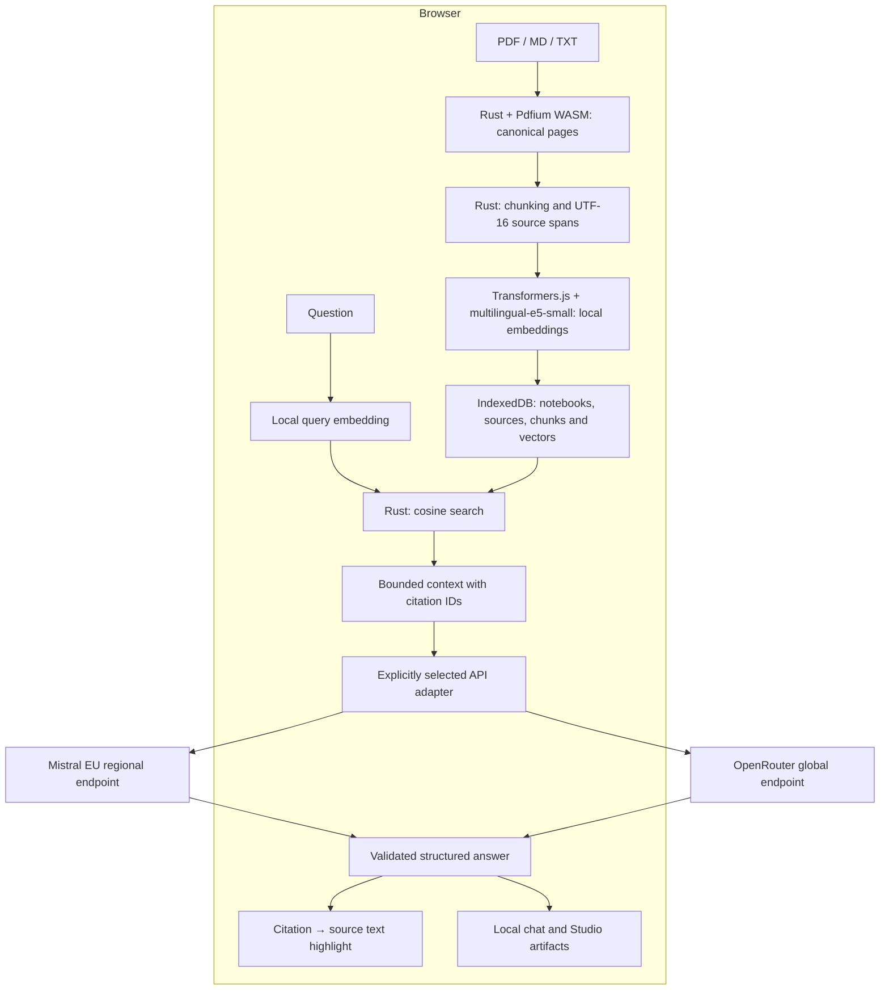

# ResearchBench · v0.0.1

**Deine Quellen. Dein Wissen. Dein Browser.**

A browser research workbench built for the Everlast Consulting test assignment:
upload documents, ask grounded questions, inspect the exact cited passage, and
turn a notebook into a summary, FAQ or study guide.

Documents, chunking, embeddings, indexing and semantic search run locally.
Generation uses your own **Mistral La Plateforme** key by default, with
**OpenRouter** as an explicit alternative. There is no application backend.

## Run locally

Requirements: Node.js 22.17 or later, pnpm 11.28.5, Rust/Cargo and the
`wasm32-unknown-unknown` target. The first setup needs network access to download
public dependencies and pinned model/runtime assets.

```sh
pnpm install --frozen-lockfile
rustup target add wasm32-unknown-unknown
pnpm assets:prepare
pnpm wasm:build
pnpm dev
```

Open the URL printed by Vite. In **Einstellungen**, select the API connection and
enter its key. Keys stay in `sessionStorage`, survive reload in that tab, and
are never included in the build, IndexedDB or repository. Local search works
without any key.

`wasm:build` installs the pinned wasm-bindgen CLI into the project's
`.cache/tools` when necessary. Native ONNX installation scripts are deliberately
disabled: inference uses ONNX Runtime Web in a browser Worker. TypeScript 6 is
pinned because SvelteKit currently requires its JavaScript compiler API.

## What you can do

- Create, rename and remove notebooks; import multiple PDF, Markdown and TXT sources.
- Search semantically in German and English using local multilingual embeddings.
- Ask questions and click citations to open the exact highlighted source span.
- Generate summaries, FAQs and study guides with the same citation contract.
- See whether a generated item covers the complete text or a bounded selection.
- Reload without losing sources, indices, chat or generated material.
- Cancel indexing/generation, change API connection, remove sources or wipe all app data.

The interface is German. Answers follow an explicitly requested language;
German is the default. Source viewing displays extracted text with PDF page
anchors, not overlays in the original PDF.

## Architecture



### Rust and Workers

The Rust crate provides strict UTF-8 decoding, canonical per-page text, fixed
Unicode-scalar windows with overlap, exact half-open **UTF-16** spans for browser
highlighting, and cosine retrieval over a row-major `Float32Array`. Window
defaults are 1,000 characters with 200 overlap, confined to each page.

`pdfium-render` binds a separately shipped, pinned Pdfium WASM module. The JS
bridge only initializes modules and transports results; PDF parsing remains in
the Rust/Pdfium path. Pdfium calls and ONNX inference run off the main thread.
Cancellation terminates the Worker, including synchronous parsing/inference.
There is one primary PDF parser; alternative parsers are not silently selected.

### Local embeddings

The default is quantized **multilingual-e5-small**, pinned to the ONNX revision
in the asset manifest. Queries use `query:`, passages use `passage:`, followed
by mean pooling and normalization. The 512-token limit includes prefixes and
special tokens; oversized windows are split again without losing source spans.
Long current questions are rejected rather than silently truncated. Previous
questions are included only within the remaining token budget.

The first import downloads approximately 160 MB of model, tokenizer and needed
WASM runtime assets **from this app's origin**. The complete deployment asset
set is larger because it includes runtime variants and license notices. Browser
caches can be evicted; their persistence is not guaranteed. Remote model loading
is disabled. E5 was chosen for multilingual retrieval, browser-ready ONNX
weights and a bounded download, rather than model novelty.

### Data integrity and provenance

Notebook and source IDs exist from the first import. A source becomes searchable
only when its pages, chunks and vectors have been committed atomically.
Parser/model/pipeline versions accompany the index; incompatible indices request
reindexing. Each operation captures notebook/source revision and API configuration.
Revision checks and abort-aware transactions prevent canceled or outdated jobs
from saving results into a changed or deleted notebook.

Chat sends at most four conversation pairs from the current source revision.
Source changes start a new active conversation context; old visible answers and
Studio items remain labeled as referring to an older source state. Deleted
citations are unavailable. API switches abort active generation; there is no
automatic cross-provider or cross-region fallback.

### Grounding and Studio coverage

Chat uses the top six local retrieval results. Both adapters request a JSON
schema and normalize into one client-side validated answer type. Only citation
IDs from the actual submitted context can become clickable references.
Request and validation bounds derive from the same schema. A section may cite
up to the number of distinct transmitted passages; there is no fixed twelve-reference
cap. Size violations produce diagnostics without revealing response contents.
Validation proves source-ID membership and exact navigation, **not** whether a
model's factual claim is truly entailed by the cited passage.

Studio generators use the whole canonical source text up to 24,000 characters,
without repeated overlap. Larger notebooks use a round-robin selection of
spread-out, non-overlapping passages from all sources. The UI shows selected
sources, text coverage and the selection limitation. This is not advertised as
a complete summary of a large notebook.

## API connections

| Connection | Endpoint | Default model |
| --- | --- | --- |
| Mistral direct (default) | `https://api.eu.mistral.ai/v1/chat/completions` | `mistral-small-2603` |
| OpenRouter (alternative) | `https://openrouter.ai/api/v1/chat/completions` | `mistralai/mistral-small-2603` |

Each connection has its own session key. Only the selected connection receives a
generation request. OpenRouter's adapter requests `data_collection: "deny"`,
`zdr: true` and `require_parameters: true`. Those fields are never sent to
Mistral. Missing eligible endpoints cause a visible error; privacy requirements
are not relaxed automatically. Requests use no tools, web-search plugins, OCR
APIs, file-upload APIs or external embedding APIs.

Invalid keys, insufficient credits/access, unavailable regional models,
rate limits, invalid JSON/citations, timeouts and cancellation have separate
user-facing outcomes. Raw provider error bodies are not displayed or logged.

Use a funded key and the paid, pinned model for a live demo. A free-model quota
or model switch is not part of the reliable demo path. No credits are bought or
keys created by the setup scripts.

## Privacy and GDPR: precise boundaries

1. **Local processing:** original documents, canonical text, embeddings and indices
   are stored in this browser profile. Import and search send no document content
   to an external service. The app has no analytics, tracking cookies or document backend.
2. **External generation:** selected excerpts, questions/generation instructions,
   bounded conversation history and the chosen API's authorization key leave the
   browser when the user starts generation. The selected API connection is visible.
3. **Mistral:** ResearchBench targets the EU regional inference endpoint. This is
   a processing-location choice, not a universal GDPR compliance assertion.
   Mistral documents EU/EFTA infrastructure and control-plane metadata that may
   remain outside the selected inference geography. Training opt-out and retention
   are separate account controls. Paid usage alone does not activate ZDR; it must
   be requested and approved. ResearchBench does not inspect or certify those settings.
4. **OpenRouter:** the standard connection goes through OpenRouter, a US company,
   and is forwarded to the selected model endpoint. ZDR and data-collection filters
   constrain eligible upstreams; they do not make the standard gateway EU-resident.
   OpenRouter currently documents Business/Enterprise regional routing, where
   prompts are decrypted and processed in-region, and a DPA through its Terms of
   Service (signed copies on request for Business). These are not properties of
   ResearchBench's default OpenRouter connection.
5. **Deletion:** the confirmed app-data wipe aborts active work and clears its
   IndexedDB records, in-memory state, session keys and its named model cache.
   It does not delete unrelated origin data or retract requests already processed
   by an external API. Static hosting can retain access metadata under its own policy.

Authoritative sources (reviewed October 2026): [Mistral regional inference](https://docs.mistral.ai/inference/regional-inference),
[Mistral training controls](https://help.mistral.ai/en/articles/347617-do-you-use-my-user-data-to-train-your-artificial-intelligence-models),
[Mistral ZDR](https://docs.mistral.ai/admin/monitor-comply/zero-data-retention),
[OpenRouter routing](https://openrouter.ai/docs/guides/routing/provider-selection),
[OpenRouter ZDR](https://openrouter.ai/docs/guides/features/zdr),
[OpenRouter Business and DPA](https://openrouter.ai/business).

The [DSK orientation on RAG (October 2025)](https://www.datenschutzkonferenz-online.de/media/oh/DSK_OH_RAG.pdf)
explains why RAG does not automatically settle data protection questions. Local
storage, bounded disclosure, transparent provenance and deletion support a
privacy-conscious design; lawful production use still depends on the actual
documents, purpose, contracts and provider configuration.

## Limits and deliberate trade-offs

- Text-based PDF, UTF-8 Markdown and TXT; scanned/image-only PDFs need OCR and are rejected.
- 10 MiB/file, ten sources, 500,000 canonical characters and 1,000 chunks/notebook.
- A five-minute local job watchdog prevents indefinite processing; smaller sources may be needed.
- Fixed-size chunking is simple and testable, but can cut semantic boundaries.
- No cloud sync, collaborative accounts or encryption at rest beyond the browser's storage protections.
- Primary acceptance browsers are Chromium and Firefox, including CPU/WASM without WebGPU.
- Experimental WebLLM generation is an optional bonus and is not included in this version.

The differentiator is the combination of zero server setup for the visitor,
Rust/WASM provenance, multilingual local retrieval, explicit provider choice,
bounded disclosure and cited learning artifacts. This repository does not claim
to be the only product with that combination or that Rust alone improves retrieval.

## Verification

```sh
pnpm verify
pnpm assets:prepare -- --verify
PLAYWRIGHT_BROWSERS_PATH=.cache/ms-playwright pnpm exec playwright install chromium firefox
pnpm test:e2e
```

Tests cover Unicode spans, retrieval math, schema/citation validation, provider
request isolation, IndexedDB revisions and cancellation. The browser suite uses
the actual Rust/Pdfium Worker and local E5 model, original DE/EN fixture PDFs,
reload/notebook isolation, exact highlights, all three generators, bounded
coverage, unsafe source rendering and deletion. API responses use route mocks
with test-only keys; actual account entitlements and live generation require a
manual test using the key entered in the UI.

The recorded local acceptance results and remaining manual gates are in
[the verification report](docs/verification.md).

## Static deployment and submission

```sh
pnpm build
pnpm preview
```

Publish the **entire** `build/` directory, including models, runtimes and notices,
to an HTTPS static host with SPA fallback to `index.html`. WASM must be served as
`application/wasm`, JavaScript modules with a JavaScript MIME type. No runtime
environment secrets or proxy service are needed. CI verifies builds/tests and
does not push, deploy or publish a release.

Before submission: test the deployed hostname, demo import speed and a funded
key; record Loom in at most ten minutes using [the demo outline](docs/loom-script.md).
The repo URL, live URL and video link are then included in the application reply.
Publishing and sending remain explicit human actions.

See [THIRD_PARTY_NOTICES.md](THIRD_PARTY_NOTICES.md) for redistribution notices.
